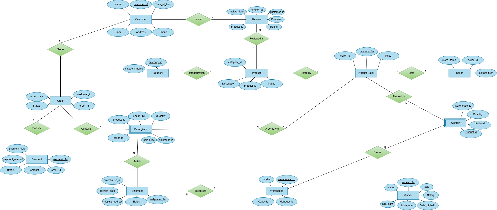

# Amazon-Style E-Commerce Database

A relational database for an online marketplace modeled on Amazon: customers, multi-seller product listings, orders, payments, shipments, warehouses, inventory and reviews. Built in MySQL as a university database course project (Spring 2026, Group 026).

> Educational project. It is modeled on the general structure of large online marketplaces and is not affiliated with Amazon.



## Overview

The database stores and organizes everything an online store needs to operate:

- customer names and addresses
- product details and seller prices
- who bought what, and how they paid
- where items are stored in warehouses
- how and when orders are shipped to customers

### Why an Amazon-style marketplace?

It is a rich, realistic business to model: thousands of products, many competing sellers, and warehouses spread across the country. It combines three problem areas in one schema: **e-commerce** (catalog, orders, payments, reviews), **logistics** (shipments, warehouses, staff) and **inventory** (stock per seller and per warehouse). The goal was to turn that messy domain into a clean, logical design that a database can query and update reliably.

## Highlights

- **13 tables normalized to 3NF.** Derived values (age, tenure, subtotals, order totals, average ratings) are computed in queries instead of stored, so they can't go stale.
- **Marketplace model.** Several sellers can offer the same product at different prices (`ProductSeller`), and each order line points at one specific seller's listing (`OrderItem`).
- **Price history is preserved.** `OrderItem.unit_price` stores the price paid at purchase time, so later price changes don't rewrite past orders.
- **Physical stock is separate from listings.** `Inventory` links a seller's listing to a warehouse through a composite foreign key.
- **Integrity enforced by the database:** primary and foreign keys, unique emails, `CHECK` constraints (ratings 1-5, positive quantities and prices, a delivered shipment must have a delivery date), `ENUM` statuses, and one review per customer per product.
- **21 example queries**, from basic lookups to CTEs, window functions and a self-join for market-basket analysis.

## Database design

### Tables

| Table | Purpose | Primary key |
|---|---|---|
| `Customer` | Shoppers | `customer_id` |
| `Seller` | Merchants on the marketplace | `seller_id` |
| `Category` | Product categories | `category_id` |
| `Product` | Catalog items | `product_id` |
| `ProductSeller` | Which seller offers which product, and at what price | `(product_id, seller_id)` |
| `Order` | Customer orders | `order_id` |
| `OrderItem` | Line items: listing, quantity, price paid, shipment | `(order_id, product_id, seller_id)` |
| `Payment` | Payments against orders | `payment_id` |
| `Shipment` | Shipments leaving a warehouse | `shipment_id` |
| `Warehouse` | Fulfillment centers, each with a manager | `warehouse_id` |
| `Worker` | Warehouse staff | `worker_id` |
| `Inventory` | Stock of a seller's listing in a warehouse | `(warehouse_id, product_id, seller_id)` |
| `Review` | Customer ratings and comments | `review_id` |

`Order` is a reserved word in MySQL, so it is always written with backticks.

### Relationships

| Relationship | Cardinality | Notes |
|---|---|---|
| Customer - Order | 1 : N | A customer places many orders |
| Order - OrderItem | 1 : N | An order contains many line items |
| Order - Payment | 1 : N | An order can have more than one payment record (for example a retry or a refund) |
| Product - ProductSeller - Seller | M : N | `ProductSeller` is the junction table; it holds the price |
| ProductSeller - OrderItem | 1 : N | Each line item refers to one seller's listing |
| Shipment - OrderItem | 1 : N | One shipment can carry several items; an order can be split across shipments |
| Warehouse - Shipment | 1 : N | Shipments leave from a warehouse |
| Warehouse - Inventory | 1 : N | A warehouse stocks many listings |
| ProductSeller - Inventory | 1 : N | A listing's stock can be spread across warehouses |
| Category - Product | 1 : N | |
| Product - Review | 1 : N | |
| Customer - Review | 1 : N | A customer can review a product only once |
| Worker - Warehouse | 1 : N | A worker can manage warehouses through `manager_id` |

### How the ER diagram was built

1. Identify the main entities (Customer, Product, Order, Seller, ...).
2. Define each entity's attributes (for example Customer: name, email, phone).
3. Identify the relationships between entities.
4. Convert many-to-many relationships into tables (`OrderItem`, `ProductSeller`).

The editable source is in `docs/ER_diagram.drawio` (open it with draw.io).

### Normalization

**1NF: atomic values, no repeating groups, every row identifiable.** Storing several seller IDs inside one product record would break this. Instead the many-to-many relationship between products and sellers is moved into the `ProductSeller` intersection table. Orders and products relate the same way through `OrderItem`.

```
Seller  (1)--(N)  ProductSeller  (N)--(1)  Product
Order   (1)--(N)  OrderItem      (N)--(1)  ProductSeller
```

**2NF: no partial dependencies.** In `OrderItem`, `quantity` needs both the order and the product to be known, and `unit_price` is the price at the time of purchase, so both depend on the whole composite key.

**3NF: no transitive dependencies.** Anything that can be calculated from other columns was removed:

| Dropped column | Table | Why |
|---|---|---|
| `age` | `Customer`, `Worker` | Derivable from `date_of_birth` |
| `tenure` | `Worker` | Derivable from `hire_date` |
| `subtotal` | `OrderItem` | `quantity * unit_price` |
| `total_amount` | `Order` | Sum of its items |
| `average_rating` | `Seller`, `Product` | Aggregate of `Review` |

### Keys

Every table has a single-column or composite primary key (see the table list above). Foreign keys:

| Foreign key | References |
|---|---|
| `Product.category_id` | `Category.category_id` |
| `ProductSeller.product_id` | `Product.product_id` |
| `ProductSeller.seller_id` | `Seller.seller_id` |
| `Inventory.warehouse_id` | `Warehouse.warehouse_id` |
| `Inventory.(product_id, seller_id)` | `ProductSeller.(product_id, seller_id)` (composite) |
| `Warehouse.manager_id` | `Worker.worker_id` |
| `Order.customer_id` | `Customer.customer_id` |
| `OrderItem.order_id` | `Order.order_id` |
| `OrderItem.(product_id, seller_id)` | `ProductSeller.(product_id, seller_id)` (composite) |
| `OrderItem.shipment_id` | `Shipment.shipment_id` (nullable, so items can wait for a shipment) |
| `Shipment.warehouse_id` | `Warehouse.warehouse_id` |
| `Review.product_id` | `Product.product_id` |
| `Review.customer_id` | `Customer.customer_id` |
| `Payment.order_id` | `Order.order_id` |

Candidate and super keys for each table are listed in `docs/Keys_and_Relations.pdf`; attributes per entity are in `docs/Entities.pdf`.

## Getting started

Requires **MySQL 8.0.16 or later** (older versions parse but ignore `CHECK` constraints, and window functions need 8.0+).

```bash
mysql -u <user> -p < sql/schema.sql    # creates AmazonDB (drops it first if it exists)
mysql -u <user> -p < sql/seed.sql      # loads the sample data (clears existing rows first, safe to re-run)
mysql -u <user> -p < sql/queries.sql   # runs the example queries
```

Or open the three files in MySQL Workbench and run them in that order.

## Example queries

`sql/queries.sql` has 21 queries in five sections:

- **A. Basics:** filtering, sorting, joins, counts
- **B. Sales and customers:** revenue per order, top customers, same-day order check, a CTE-based customer summary, an order/payment/shipment status overview
- **C. Products, reviews and sellers:** underperforming products, review sentiment with `CASE`, seller leaderboard, market-basket pairs
- **D. Warehouses and inventory:** stock distribution, dead stock, manager audit, workers above average salary
- **E. Window functions:** revenue rank within each category, running daily revenue

## Repository layout

```
sql/
  schema.sql    table definitions, constraints, indexes
  seed.sql      sample data
  queries.sql   example queries
docs/
  ER_diagram.png / .drawio   entity-relationship diagram (editable in draw.io)
  Entities.pdf               entities and attributes
  Keys_and_Relations.pdf     primary, candidate and super keys
```

## About the sample data

The data is hand-written and deliberately small (10-18 rows per table) so every query result can be checked by eye. It is internally consistent: payments match order totals, a shipment is `Delivered` only when it has a delivery date, and every review comes from a customer whose order for that product was delivered before the review. A few records exist on purpose to exercise edge cases, such as a customer with no orders (`LEFT JOIN`) and stock that was never ordered (dead-stock query).

## Limitations and possible extensions

- Statuses are fixed `ENUM`s; a lookup table would be easier to extend.
- Customers have a single free-text address, with no separate address book.
- Warehouse managers are identified by the `role` text on `Worker`, which the schema does not enforce.
- No stored procedures, triggers or views yet; for example, a trigger could decrement `Inventory` when an order ships.
- Performance was not benchmarked: the indexes are sensible defaults, not tuned against a large dataset.

## Team

Group project by **Parinaz Ghasemi, Sara Kiyanmehr and Mohammad Mahdi Sadeghi** (Group 026).

**My contribution:** I defined the entities and their relationships (`docs/Entities.pdf`) and worked out the primary, candidate, super and foreign keys (`docs/Keys_and_Relations.pdf`). I also helped build the ER diagram and write the SQL code.
